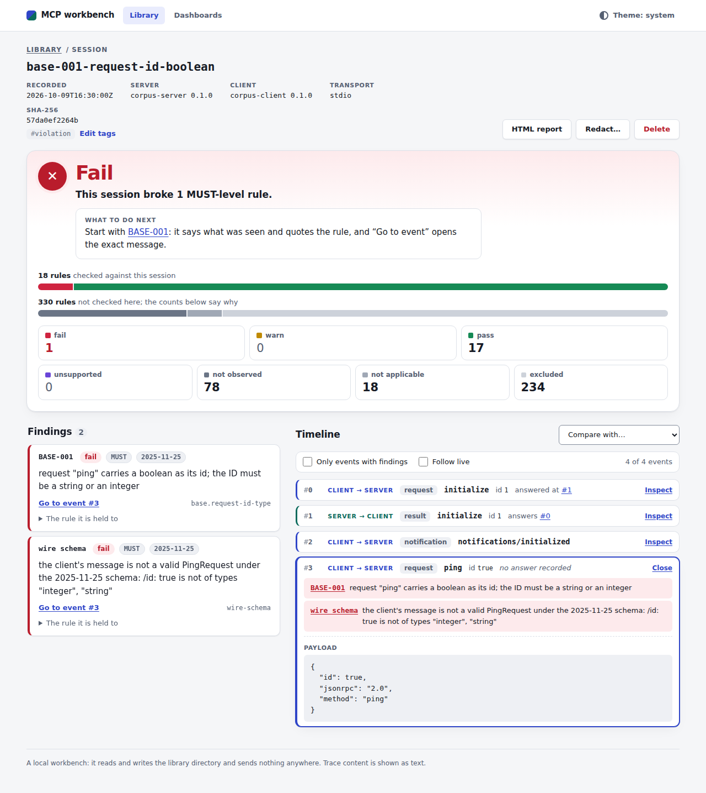

<!-- SPDX-License-Identifier: MIT -->
<!-- Copyright 2026 Tom F. (https://github.com/tomtom215) -->

# mcp-conformance

[](https://github.com/tomtom215/mcp-conformance/actions/workflows/ci.yml?query=branch%3Amain)
[](https://crates.io/crates/mcp-trace-validator)
[](https://docs.rs/mcp-trace-validator)
[](STABILITY.md)
[](LICENSE)

**Find out which sentences of the [Model Context Protocol](https://modelcontextprotocol.io)
specification your MCP server keeps, which it breaks, and which it was never asked
about.** One command, no client to write, no SDK, no Node.js:

```text
mcp-conformance check -- python my_server.py           # a stdio server
mcp-conformance check --url http://localhost:3000/mcp   # a Streamable HTTP server
```

`check` talks to the server the way a conforming client does, records every byte
through a tap, and judges the recording against the specification clause by clause,
for the `2025-11-25` and `2026-07-28` revisions. Each finding names the requirement,
the message that broke it, the specification's own sentence, and a link to it.
The exit code is the verdict, so the same command is a CI gate.

| If you | Start at |
|--------|----------|
| write or run an MCP server | [Quickstart](#quickstart) |
| write an MCP client or an SDK | [Judge traffic you already have](#judge-traffic-you-already-have) |
| want a conformance gate in CI | [Use it in CI](#use-it-in-ci) |
| want to know what is judged, and what is not | [Requirement coverage](#requirement-coverage) |

**Status: `0.7.0`.** The libraries, the recorder and the validator are on
[crates.io](https://crates.io/crates/mcp-trace-validator). The `mcp-conformance`
binary ships as [release archives](https://github.com/tomtom215/mcp-conformance/releases),
npm and PyPI packages and a container image ([Install](#install)).
Pre-1.0: the API and the verdicts may change between minor releases, and the
[changelog](CHANGELOG.md) says so when they do; `0.7.0` does, and its
[breaking-changes table](CHANGELOG.md#070---2026-11-21) lists each one with its
migration.

## Contents

- **Use it:** [Quickstart](#quickstart) · [Install](#install) ·
  [The commands](#the-commands) · [Use it in CI](#use-it-in-ci) ·
  [Judge traffic you already have](#judge-traffic-you-already-have)
- **Understand it:** [Read a report](#read-a-report) ·
  [Requirement coverage](#requirement-coverage) · [How it works](#how-it-works) ·
  [How this relates to other tools](#how-this-relates-to-other-tools)
- **The project:** [The crates](#the-crates) · [Documentation](#documentation) ·
  [Security](#security) ·
  [Stability, contributing and license](#stability-contributing-and-license)

## Quickstart

**1. Install `mcp-conformance`**, whichever way suits you ([Install](#install) lists
them all):

```text
npm install -g mcp-conformance        # or run it without installing: npx mcp-conformance …
pip install mcp-conformance
cargo install --locked --git https://github.com/tomtom215/mcp-conformance --tag v0.7.0 mcp-conformance-cli
```

**2. Point it at a server**, with the server's own start command after `--`, or its
endpoint with `--url`. This run checks the repository's reference server
(`cargo install --locked mcp-everything-server`); yours goes in its
place:

```text
$ mcp-conformance check -- mcp-everything-server
mcp-trace-capture: recording to /tmp/mcp-conformance-check-9903-907254515/session.jsonl
mcp-conformance check: mcp-everything-server (stdio)
  revision   2025-11-25 — `server/discover` was not answered as a 2026-07-28 server answers it, so the session fell back to `initialize`
  server     mcp-everything-server 0.7.0
  tools      21 listed, 1 called
  resources  3 listed, 3 read
  prompts    5 listed, 3 fetched
  not called:
    add, echo, get-structured-content, json_schema_2020_12_tool, test_audio_content, test_elicitation, test_elicitation_sep1034_defaults, test_elicitation_sep1330_enums and 12 more — not annotated read-only (`readOnlyHint: true`); name it with --call, or use --call-all
  not read:
    test://template/{id}/data, test://annotated/{id} — a template needs values, and nothing states them
  not fetched:
    test_prompt_with_arguments, test_prompt_with_embedded_resource — it requires arguments, which have names and no schema to build a value from
  probes     5 sent: requests made wrong on purpose, to see how the server refuses them (--no-probes leaves them out)
    resources/read for a resource the server does not have — refused with an error
    prompts/get for a prompt the server does not list — refused with an error
    prompts/get test_prompt_with_arguments without the arguments it requires — refused with an error
    logging/setLevel with a level that is not one — refused with an error
    completion/complete for a prompt the server does not list — served
  requests   23 sent
  trace      /tmp/mcp-conformance-check-9903-907254515/session.jsonl
MCP trace validation — revision 2025-11-25 (declared by the trace)
  WARN  LOG-003 (SHOULD)
        [server] seq 45: `logging/setLevel` named level "mcp-conformance-probe", which is not one of the eight RFC 5424 levels, and drew error -32601 rather than -32602
        spec: "Servers SHOULD return standard JSON-RPC errors for common failure cases: Invalid log level: `-32602` (Invalid params); Configuration errors: `-32603` (Internal error)"
        see:  https://modelcontextprotocol.io/specification/2025-11-25/server/utilities/logging#error-handling
  FAIL  wire schema — fail (1 of 47 messages invalid)
        [client] seq 44: the client's message is not a valid SetLevelRequest under the 2025-11-25 schema: /params/level: "mcp-conformance-probe" is not one of "alert", "critical" or 6 other candidates
        spec: "This is the source of truth for all protocol messages and structures."
        see:  https://modelcontextprotocol.io/specification/2025-11-25/basic#schema
        schema: https://github.com/modelcontextprotocol/modelcontextprotocol/blob/8a18b4b3292b9f9b3aee73f6325f9f62f19a89f9/schema/2025-11-25/schema.json
totals: 43 pass, 0 fail, 1 warn, 225 excluded, 0 unsupported, 0 not applicable, 79 not observed
wire schema: fail (1 of 47 messages invalid)
verdict (server findings only): pass-with-warnings — 1 client finding set aside
mcp-conformance check: result: the server broke no rule this run could judge (warnings, if any are listed, are the specification's recommendations)
mcp-conformance check: findings marked [client] are this tool's own probes (requests made wrong on purpose) and do not count against the server
mcp-conformance check: the report as a page to open in a browser: /tmp/mcp-conformance-check-9903-907254515/report.html
```

(A run of `main` on 2026-11-21, exit status `0`. The directory under `/tmp` is new on
every run.)

**3. Read it.**

| Part of the output | What it tells you |
|--------------------|-------------------|
| `mcp-conformance check:` down to `trace` | The run's own account, on stderr: the revision negotiated, what was listed, called and read, what was left alone and why, and each probe with how the server answered it |
| `WARN  LOG-003 (SHOULD)` | A finding: the requirement's ID and level, the party it is held against (`[server]`), the event in the recording (`seq 45`), what was seen, the specification's sentence, and a link to it |
| `FAIL  wire schema` … `[client]` | A finding held against the client, which here is `check` itself: the invalid log level it sent on purpose is not a valid message. The verdict line sets it aside |
| `totals:` | Every clause of the revision, counted under one of [seven outcomes](#read-a-report). 43 passed; 76 were *not observed*, which is not a pass |
| `verdict` and the exit status | `pass-with-warnings`, exit `0`. A broken MUST is `fail`, exit `1` |
| The last line | `report.html`, the same report as one page to open in a browser |

**What `check` does to your server, and what it does not:**

- **It reads.** It lists what the server declares, reads the resources it lists, gets
  the prompts that need no arguments, and calls only the tools the server itself
  annotates `readOnlyHint: true`. Every other tool is named with the reason it was
  left alone. `--call <tool>` and `--call-all` call more, and the side effects are
  then yours.
- **It does not guess.** Arguments are built from the tool's own `inputSchema` and
  checked against it; where the schema does not say enough, the tool is skipped and
  the summary says so.
- **It probes, from a short fixed list.** After the ordinary requests it asks for a
  prompt and a resource the server does not have, and sends a few requests made
  wrong on purpose, because the specification says how a server refuses each. None
  can change anything on the server; `--no-probes` leaves them out. `check` is not a
  fuzzer or a security scanner.
- **It is bounded.** At most 100 requests, 25 tool calls, 30 seconds an answer and
  five minutes in all by default; each bound is a flag, and the summary says when one
  stopped the run.
- **It says what it did not see.** A clean report over 23 requests is a claim about
  23 requests: the clauses the session never reached are counted *not observed*,
  never passed.
- **The recording is yours.** `-o` names the trace; `mcp-conformance validate`
  re-judges it and `mcp-conformance serve` opens it in a local workbench.

The flags used most:

| Flag | What it does |
|------|--------------|
| `--call <tool>`, `--call-all` | Call a named tool, or every listed tool, whatever its annotations |
| `--no-probes` | Send only the ordinary requests |
| `--spec-version 2025-11-25` or `2026-07-28` | Speak one revision instead of negotiating |
| `--header "Authorization: Bearer …"` | Send a credential to an HTTP server; its value is not written to the trace |
| `--strict` | Warnings (SHOULD-level findings) fail too |
| `--format json`, `junit`, `sarif` or `html` | Print the report in another format |
| `--html-report <file>` | Also write the HTML page to a file, whatever `--format` prints |
| `--write-baseline <file>`, `--baseline <file>` | Record today's findings, then fail only on new ones |
| `-o <file>`, `--summary <file>` | Keep the recording; write the run's account as JSON |

`mcp-conformance check --help` has every flag, and the book's
[Checking a server](book/src/checking.md) chapter has the rest: exactly what is
sent, the probes, the bounds, servers that want a credential.

## Install

| What | How |
| ------ | ----- |
| All three binaries, from npm | `npm install -g mcp-conformance`, or `npx mcp-conformance …` to run without installing |
| All three binaries, from PyPI | `pip install mcp-conformance` |
| All three binaries, as release archives | [GitHub releases](https://github.com/tomtom215/mcp-conformance/releases) |
| All three binaries, as a container image (linux/amd64) | `docker run --rm ghcr.io/tomtom215/mcp-conformance:0.7.0 mcp-conformance --help` |
| `mcp-conformance`, built from source | `cargo install --locked --git https://github.com/tomtom215/mcp-conformance --tag v0.7.0 mcp-conformance-cli` |
| The recorder and the validator alone, from crates.io | `cargo install --locked mcp-trace-capture mcp-trace-validator` (or `cargo binstall` for the prebuilt binaries) |
| The GitHub Action, with nothing to install | [Use it in CI](#use-it-in-ci) |

- **The three binaries** are `mcp-conformance` (every command in this README),
  `mcp-trace-capture` (the recorder alone) and `mcp-trace-validator` (the judge
  alone). `mcp-conformance` is not on crates.io: it is a binary, distributed as one.
- **npm, PyPI and the container image are new in `0.7.0`.** No earlier version exists
  under those names.
- **Release archives** are built for Linux (static, x86_64 and aarch64), macOS (arm64
  and x86_64) and Windows (x86_64), with SLSA build-provenance attestations
  (`gh attestation verify <archive> --repo tomtom215/mcp-conformance`) and a
  `SHA256SUMS-binaries` file.
- **`mcp-conformance test`** also needs Node.js 18 or newer with `npx`, because it
  runs the official conformance suite. No other command needs Node.js.

## The commands

`mcp-conformance` is one binary with these subcommands:

| Subcommand | Use it to |
|---------|-----------|
| `check` | Exercise a server and get its clause report. Start here ([book](book/src/checking.md)) |
| `validate` | Judge traces already recorded ([book](book/src/reading-a-report.md)) |
| `watch` | Sit between your client and a server, record the session, and print each finding as it happens ([book](book/src/watching.md)) |
| `test` | Run the pinned official conformance suite through the recorder and report whether its verdict and the clause report agree ([book](book/src/testing.md)) |
| `serve`, `library` | Browse, search and compare a library of recordings in a local workbench ([book](book/src/workbench.md)) |
| `requirements` | Look up the requirements: all, some, or one in full by its ID, such as `BASE-003` |
| `completions` | Print a shell completion script |

Two more binaries do one job each:

| Binary | What it is |
|--------|------------|
| `mcp-trace-capture` | The recorder on its own: a stdio wrapper and an HTTP reverse proxy ([README](crates/mcp-trace-capture/README.md)) |
| `mcp-trace-validator` | The judge on its own: the same `validate`, `requirements` and `completions` ([README](crates/mcp-trace-validator/README.md)) |

A report comes in five formats (`--format`):

| Format | For |
|--------|-----|
| `human` (the default) | Reading in a terminal |
| `json` | Scripts. The whole report as data, described by a [JSON Schema](crates/mcp-trace-validator/schema/report.schema.json) |
| `junit` | CI systems that read test reports |
| `sarif` | Code scanning (SARIF 2.1.0): GitHub, GitLab, IDEs |
| `html` | People. One self-contained page that loads no script, font or image: the verdict, each finding at its event in the message timeline, and the accounting of every other clause ([a failing report, as CI screenshots it](visual/tests/__screenshots__/fail-desktop-light.png)) |

The workbench (`mcp-conformance serve`) shows the same report beside the session's
timeline, for every recording in a directory:



It listens on `127.0.0.1` only, behind a single-use link, and sends nothing anywhere.

## Use it in CI

**On GitHub Actions, the repository is the action.** One step checks a server and
writes SARIF, JUnit and the HTML page; the step fails when a clause does:

```yaml
- uses: tomtom215/mcp-conformance@<commit SHA>
  with:
    check: python my_server.py                    # or: check-url: http://127.0.0.1:3000/mcp
- uses: github/codeql-action/upload-sarif@<sha>   # optional: findings in code scanning
  if: always()
  with:
    sarif_file: mcp-conformance.sarif
```

| Input | What it does |
|-------|--------------|
| `check`, `check-url` | A stdio server's command line, or an HTTP endpoint, to exercise and judge |
| `check-options` | Extra `check` flags: `--call-all`, `--call <tool>`, `--spec-version …`, bounds |
| `traces` | Recorded traces to judge, as paths or globs |
| `capture`, `server`, `client`, `upstream` | Record your own client's sessions and judge them |
| `baseline` | A file of accepted findings; only findings it does not list fail the step |
| `strict`, `party`, `revision` | Warnings fail; count one party's findings; name the revisions |
| `version` | A release whose prebuilt, checksum-verified binaries to download; empty builds from the action's own source |
| `sarif-file`, `junit-file`, `html-file`, `fail-on-findings` | Where the reports go, and whether findings fail the step |

Three things to know before you add it:

- **It needs no token and no permissions.** Only the optional `upload-sarif` step
  needs `security-events: write`.
- **`check`, `server` and `client` are command lines run by bash.** Give them text
  you wrote; do not build them from a pull request's title, branch name or any other
  input an outsider controls.
- **Pin it by commit SHA**, as GitHub recommends for every action. With `version`
  empty the step compiles the tools from that commit. Setting `version` downloads a
  release's binaries instead; the `check` inputs need a release that has `check`
  (`0.7.0` or later).

[`action.yml`](action.yml) documents every input and output, and the book's
[CI chapter](book/src/ci.md) covers the rest, other CI systems included.

**Anywhere else, the exit status is the verdict:** `0` nothing held against the
server (warnings pass unless `--strict`), `1` a clause failed, `2` the run could not
be made or judged.

```text
mcp-conformance check --format junit --strict -- python my_server.py > mcp.xml
```

**Adopting it on a server that already has findings.** Record them once, then fail
only on new ones; the accepted findings stay in every report, marked:

```text
mcp-conformance check --write-baseline mcp-baseline.json -- python my_server.py
mcp-conformance check --baseline mcp-baseline.json --strict -- python my_server.py
```

An entry that no longer matches anything fails the run, so a baseline cannot outlive
the defect it excuses ([ADR-0025](docs/plan/decisions/0025-a-baseline-for-validate.md)).

## Judge traffic you already have

`check` exercises a server with a client of its own. To judge what *your* client and
server said to each other, in any language, record the session and validate it:

```text
# stdio: have your client launch this instead of the server
mcp-trace-capture -o session.jsonl stdio -- python my_server.py

# HTTP: point your client at this proxy (http://127.0.0.1:8080/mcp)
mcp-trace-capture -o session.jsonl http --upstream http://localhost:3000

# then judge the recording (`mcp-conformance validate` is the same command)
mcp-trace-validator validate session.jsonl
```

The recorder forwards bytes unchanged and links no MCP SDK, so the verdict describes
the wire.

| To | Read |
|----|------|
| Record from Claude Desktop, VS Code or Cursor | [Capturing from your client](book/src/clients.md) |
| Record from a test suite | [Using it in CI](book/src/ci.md) |
| Record and judge in one step, with findings as they happen | [Watching a session live](book/src/watching.md) (`mcp-conformance watch`) |
| Know what the recorder guarantees and what it leaves out | [`mcp-trace-capture`'s README](crates/mcp-trace-capture/README.md) |

## Read a report

A client that retries a multi-round-trip request with the id of the original. The
two are independent requests under `2026-07-28` and must not share an id:

```text
$ mcp-trace-validator validate session.jsonl
MCP trace validation — revision 2026-07-28 (declared by the trace)
  FAIL  MRTR-019 (MUST)
        [client] seq 2: the retry reuses id 1 from the request at seq 0; the two are independent requests and must not share one
        spec: "The JSON-RPC `id` MUST be different between the initial request and the retry, as they are independent requests."
        see:  https://modelcontextprotocol.io/specification/2026-07-28/basic/patterns/mrtr#client-requirements-basic-workflow
  FAIL  TOOL-023 (MUST)
        [client] seq 2: the retry reuses id 1 from the request at seq 0; the two are independent requests and must not share one
        spec: "Note that the JSON-RPC `id` MUST be different between the initial request and the retry."
        see:  https://modelcontextprotocol.io/specification/2026-07-28/server/tools#input-required-tool-results
  NOTE  1 request had no response when the trace ended (the recording simply stopped).
        JSON-RPC expects every request answered; no clause of this revision judges it, so the verdict is unchanged.
        client "tools/call" id 1 at seq 2
totals: 46 pass, 2 fail, 0 warn, 300 excluded, 0 unsupported, 0 not applicable, 153 not observed
wire schema: pass (3 messages valid)
verdict: fail
```

**Each finding** gives the requirement (`MRTR-019`) and its level (`MUST`), the party
it is held against (`[client]`), the event in the trace (`seq 2`), what was wrong,
the clause verbatim, and a link to it in the published revision. JSON, JUnit, SARIF
and HTML carry the same.

**The totals** count every clause of the revision under one of seven outcomes:

| Outcome | Meaning |
|---------|---------|
| `pass` | The session carried traffic the clause binds to, and every check of it found nothing wrong |
| `fail` | A MUST or MUST NOT clause was broken |
| `warn` | A SHOULD or SHOULD NOT clause was not followed. Warnings fail the run only under `--strict` |
| `not observed` | The session never did the thing the clause is about. Not a pass: there was no opportunity to break it |
| `not applicable` | The clause applies only after a capability was negotiated, and this session did not negotiate it |
| `excluded` | No recording can judge the clause; the registry gives the reason, and `--all` prints it |
| `unsupported` | This build cannot judge a clause its registry names: a mismatched installation, and exit `2` |

**The exit status** is the verdict:

| Exit | Meaning |
|-----:|---------|
| `0` | Judged, and nothing failed (warnings pass unless `--strict`) |
| `1` | A clause failed |
| `2` | The run could not be made or judged: bad arguments, an empty recording, a revision this build does not know, output not written |
| `3` | The trace is malformed or incomplete |

Six more things a report does:

- **It judges the revision the session declares**, in `initialize`, in each request's
  `_meta`, or in the `MCP-Protocol-Version` header, and says how it chose. A session
  that completed a handshake is judged under the revision the server's `initialize`
  result names. `--revision` overrides; naming two judges the session under both. A
  revision this build does not know is refused, never judged under another's rules.
- **It says whose finding it is.** `--party server` (or `client`) counts only that
  party's findings toward the verdict and the exit status, for a session the other
  side drove; the verdict line says so. `check` uses it.
- **It holds every message to the revision's JSON Schema** as well, the
  specification's own `schema.json`. That is reported beside the clause rows as the
  wire schema and not counted in their totals
  ([ADR-0020](docs/plan/decisions/0020-wire-schema-validation.md)).
- **It notes a request left unanswered, and does not judge it.** No judgeable clause
  of either revision requires the answer, so the report carries a `NOTE` and the
  verdict is unchanged.
- **It treats an empty recording as a bad invocation**, not a pass: the shape a
  broken capture step produces should fail the build.
- **It lists what needs attention**, with the first 20 findings under each clause.
  `--all` lists every clause with its outcome and, for exclusions, the reason.

The book's [Reading a report](book/src/reading-a-report.md) chapter covers triaging
a finding, baselines, raising coverage and disputing a verdict;
[Two revisions at once](book/src/revisions.md) covers revision selection.

## Requirement coverage

Every normative clause of the two revisions is a row in a registry, with a stable ID,
its verbatim quote, and either a check or a written reason no recording can judge it.
The tables are generated from the registries by `cargo xtask coverage` and verified
in CI:

<!-- coverage:begin (generated by `cargo xtask coverage`; do not edit by hand) -->
**`2026-07-28` — current revision**

| Area | Requirements | Checked | Excluded | Capability-gated |
|------|-------------:|--------:|---------:|-----------------:|
| BASE | 60 | 32 | 28 | 0 |
| TRAN | 90 | 53 | 37 | 0 |
| DISC | 4 | 3 | 1 | 0 |
| VERS | 9 | 5 | 4 | 0 |
| MRTR | 25 | 15 | 10 | 0 |
| SUBS | 7 | 4 | 3 | 0 |
| CANC | 17 | 3 | 14 | 0 |
| PROG | 8 | 5 | 3 | 0 |
| CACH | 19 | 4 | 15 | 0 |
| COMP | 6 | 3 | 3 | 0 |
| PAGE | 6 | 2 | 4 | 0 |
| LOG | 8 | 4 | 4 | 0 |
| TOOL | 31 | 17 | 14 | 0 |
| RES | 13 | 7 | 6 | 0 |
| PROM | 11 | 8 | 3 | 0 |
| ELIC | 46 | 7 | 39 | 0 |
| SAMP | 23 | 10 | 13 | 0 |
| ROOT | 9 | 3 | 6 | 0 |
| AUTH | 109 | 16 | 93 | 0 |
| **Total** | **501** | **201** | **300** | **0** |

501 requirements: 201 judged by 157 distinct trace checks, 300 carrying a documented exclusion that explains why a recorded trace cannot judge them.

**Extensions attached to `2026-07-28` — reported beside the verdict, never scored ([ADR-0023](docs/plan/decisions/0023-extensions-are-reported-never-scored.md))**

| Extension | Requirements | Checked | Excluded |
|-----------|-------------:|--------:|---------:|
| `io.modelcontextprotocol/tasks` | 49 | 25 | 24 |
| `io.modelcontextprotocol/skills` | 100 | 35 | 65 |
| **Total** | **149** | **60** | **89** |

149 extension requirements: 60 judged by 50 distinct trace checks, 89 carrying a documented exclusion. A report lists an extension's outcomes under its `extensions`, with a verdict of its own that the report's verdict and exit status never read.

**`2025-11-25`**

| Area | Requirements | Checked | Excluded | Capability-gated |
|------|-------------:|--------:|---------:|-----------------:|
| BASE | 28 | 15 | 13 | 0 |
| LIFE | 20 | 11 | 9 | 0 |
| TRAN | 52 | 18 | 34 | 0 |
| PING | 7 | 1 | 6 | 0 |
| PROG | 11 | 8 | 3 | 0 |
| CANC | 9 | 4 | 5 | 0 |
| TOOL | 18 | 9 | 9 | 13 |
| RES | 10 | 4 | 6 | 6 |
| PROM | 10 | 6 | 4 | 7 |
| LOG | 5 | 2 | 3 | 4 |
| COMP | 5 | 2 | 3 | 3 |
| PAGE | 5 | 2 | 3 | 0 |
| ELIC | 53 | 12 | 41 | 0 |
| SAMP | 20 | 10 | 10 | 0 |
| ROOT | 10 | 5 | 5 | 0 |
| AUTH | 85 | 14 | 71 | 0 |
| **Total** | **348** | **123** | **225** | **33** |

348 requirements: 123 judged by 112 distinct trace checks, 225 carrying a documented exclusion that explains why a recorded trace cannot judge them.

Every check is falsified by a committed violation trace and examines a real subject on at least one conforming one. A requirement is reported *pass* only where the session carried something it binds to: a capability-gated clause the session never negotiated reports *not-applicable*, and a clause whose subject matter never appeared reports *not-observed*. Neither is a vacuous pass.
<!-- coverage:end -->

**What is not covered:**

- **Excluded clauses.** A recording cannot judge a clause about an implementation's
  internals, its user interface, or what happens between other parties, and most of
  the authorization clauses are excluded. Each exclusion carries its reason:
  `mcp-conformance requirements --excluded` prints them.
- **Clauses a session never reached.** A pass covers what the session did. `check`
  calls only the tools a server annotates read-only unless told otherwise, and fills
  in no resource template or prompt argument, so the clauses those would exercise
  stay *not observed*.
- **Clients, from `check`.** `check` drives servers. Clauses that bind a client are
  judged on a recording of that client
  ([Judge traffic you already have](#judge-traffic-you-already-have)).
- **Other revisions.** Only `2025-11-25` and `2026-07-28` are judged; a session of an
  older revision is refused with an explanation.
- **Extensions** are reported beside the verdict and never change it.
- **Security testing.** `check` sends no random or oversized input.

The book lists every requirement with its checks or its exclusion:
[`2026-07-28`](book/src/reference/requirements-2026-07-28.md),
[`2025-11-25`](book/src/reference/requirements-2025-11-25.md),
[extensions](book/src/reference/extensions-2026-07-28.md).

## How it works

**Capture, then judge.** The validator is a pure function: a slice of trace events
in, a report out, with no network, no clock, and no I/O of its own. The recorder
writes the trace and assigns the ordering; the validator only judges it. Neither
links an MCP SDK, so a verdict describes the bytes on the wire and not one SDK's
reading of them. The same trace yields a byte-identical report on any platform,
big-endian and 32-bit included, so a regression is a diff and not a flake.
[docs/design/trace-validation.md](docs/design/trace-validation.md) has the design and
its trade-offs, and the book's [Architecture](book/src/architecture.md) chapter the
decisions that follow.

**The trace format.** A trace is JSON Lines, one event per line:

| Field | Holds |
|-------|-------|
| `seq` | The capture-assigned position, the only ordering authority |
| `direction` | `client-to-server` or `server-to-client` |
| `transport` | `stdio` or `streamable-http` |
| `kind` | `message` (a JSON-RPC payload), `http` (conformance-relevant headers, a response's status, a request's method) or `lifecycle` (transport open, close and abort) |

The format is published as a JSON Schema,
[`trace-event.schema.json`](crates/mcp-conformance-core/schema/trace-event.schema.json)
(also `mcp_conformance_core::trace::EVENT_JSON_SCHEMA`), so a recorder written in any
language can check its output without this toolkit. This `2025-11-25` session reuses
a request ID:

<!-- The mdBook chapter book/src/trace-format.md embeds the example below via
     this anchor; readme_examples.rs pins it to the validator's real output. -->
<!-- ANCHOR: trace-example -->
```jsonl
{"seq":0,"direction":"client-to-server","transport":"stdio","kind":"message","payload":{"jsonrpc":"2.0","id":1,"method":"initialize","params":{"protocolVersion":"2025-11-25","capabilities":{},"clientInfo":{"name":"my-host","version":"1.0.0"}}}}
{"seq":1,"direction":"server-to-client","transport":"stdio","kind":"message","payload":{"jsonrpc":"2.0","id":1,"result":{"protocolVersion":"2025-11-25","capabilities":{"tools":{}},"serverInfo":{"name":"my-server","version":"1.0.0"}}}}
{"seq":2,"direction":"client-to-server","transport":"stdio","kind":"message","payload":{"jsonrpc":"2.0","method":"notifications/initialized"}}
{"seq":3,"direction":"client-to-server","transport":"stdio","kind":"message","payload":{"jsonrpc":"2.0","id":1,"method":"tools/list"}}
```

and the validator answers with the violated clause, addressed to the offending
event:

```text
  FAIL  BASE-003 (MUST NOT)
        [client] seq 3: request "tools/list" reuses id 1, already used by the same party at seq 0
        spec: "The request ID MUST NOT have been previously used by the requestor within the same session."
        see:  https://modelcontextprotocol.io/specification/2025-11-25/basic#requests
totals: 18 pass, 1 fail, 0 warn, 225 excluded, 0 unsupported, 10 not applicable, 94 not observed
wire schema: pass (4 messages valid)
verdict: fail
```
<!-- ANCHOR_END: trace-example -->

The ten not-applicable rows are the capability-gated requirements this session
never negotiated (the resources, prompts, logging and completion clauses), and the
not-observed rows are the clauses whose subject matter never appeared:
nothing was paginated, no binary content was sent, no error was returned.
Neither is reported as a pass. [`corpus/`](corpus) holds complete annotated
sessions for every area, and the book's [trace format](book/src/trace-format.md)
chapter describes every field.

## How this relates to other tools

Surveyed 2026-09-24; details and sources in the
[ecosystem register](docs/plan/01-ecosystem-context.md).

| | Judges | Unit of verdict |
|---|---|---|
| [Official conformance suite](https://github.com/modelcontextprotocol/conformance), the authority | A live server or client, by driving scenarios; also validates every message against the revision's JSON schema | Scenario and check, with per-revision required sets and per-SEP traceability |
| [`mcpsnoop`](https://github.com/kerlenton/mcpsnoop) | Its own recorded captures, offline | A fixed set of MUST rules, reported as text, JUnit or SARIF |
| **This project** | Any recorded session, offline, from any implementation | One row per normative clause of the spec, each with a stable ID, its verbatim quote, and either a check or a written reason it cannot be judged |

The official suite remains the authority on what "conformant" means; this project
does not replace it. What it adds is the offline, clause-level reading: *which*
sentence of the specification a session broke, judged from a recording of real
traffic, with every clause it could not see accounted for. `mcp-conformance test`
runs the official suite and this reading together.

## The crates

| Crate | What it is |
|-------|-----------|
| [`mcp-conformance-cli`](crates/mcp-conformance-cli) | **The front door** (binary `mcp-conformance`; not on crates.io, see [Install](#install)): [the commands above](#the-commands). |
| [`mcp-trace-validator`](https://crates.io/crates/mcp-trace-validator) | **The judge**, as a library and a CLI: a pure function from trace events to a report. Every check is falsified by at least one committed violation trace in [`corpus/`](corpus). |
| [`mcp-trace-capture`](https://crates.io/crates/mcp-trace-capture) | **The recorder**: a stdio wrapper and an HTTP reverse proxy (SSE and `https://` included) that forward bytes unchanged and write the trace. |
| [`mcp-conformance-core`](https://crates.io/crates/mcp-conformance-core) | **The specification as data**: one registry entry per normative clause, with its verbatim quote, RFC 2119 level and either a check or the written reason no recording can judge it. Serde only. |
| [`mcp-everything-server`](https://crates.io/crates/mcp-everything-server) | **The calibration subject**, on [rmcp](https://github.com/modelcontextprotocol/rust-sdk): passes every server scenario the pinned official suite lists for `2025-11-25` (**47/47 checks** in 32 scenarios) and scores **42 passing / 0 failing** on the suite's pre-release `2026-07-28` scenarios; the nine committed captures at that revision evidence **149 of the 201 judgeable clauses** between them. |
| [`mcp-reference-host`](https://crates.io/crates/mcp-reference-host) | **The reference client**, on rmcp: passes the official suite's four `2025-11-25` client scenarios and, with its `oauth` feature, 19 of the 20 `auth/*` client scenarios the gate runs; scriptable sampling, elicitation and roots. |

**Calibration.** On every CI run the official suite (pinned `0.1.16`, `2025-11-25`)
drives the everything server and the reference host, the tapped sessions replay
through the validator, and any MUST-level disagreement not triaged in a committed
ledger fails the build; so does any message the validator's wire-schema check and the
suite's `wire-schema-valid` disagree about, wherever the suite reports that check.
The `2026-07-28` surface is measured weekly against the suite's pinned pre-release
(`0.2.0-alpha.12`) as a ratchet, not yet as a blocking agreement check: the suite has
no stable `2026-07-28` release to calibrate against. A weekly job also re-verifies
every registry quote against the specification's source and every link's anchor
against the published page.

## Documentation

The book is at <https://mcp-conformance.com> for the latest release and at
[`/dev/`](https://mcp-conformance.com/dev/) for `main`; the version selector switches
between them and every earlier release. The links below are its sources in
[`book/`](book), which always match this commit.

| To | Read |
|----|------|
| Check a server | [Checking a server](book/src/checking.md) |
| Install the tools, record a session and judge it | [Getting started](book/src/getting-started.md) |
| Record from a desktop client, or with no client | [Capturing from your client](book/src/clients.md) |
| Record an official SDK's own server | [Recording an SDK's server](book/src/sdk-servers.md) |
| Run the official suite and compare verdicts | [Testing a server or client](book/src/testing.md) |
| See findings while a session runs | [Watching a session live](book/src/watching.md) |
| Act on a finding, keep a baseline, dispute a verdict | [Reading a report](book/src/reading-a-report.md) |
| Browse and compare recordings | [The workbench](book/src/workbench.md) |
| Gate a build | [Using it in CI](book/src/ci.md) |
| Move to a new release | [Upgrading](book/src/upgrading.md) |
| Understand an error | [Troubleshooting](book/src/troubleshooting.md) |
| Look up a term | [Glossary](book/src/glossary.md) |
| See how real SDKs measure | [Conformance results](book/src/conformance-results.md), [the cross-SDK matrix](book/src/sdk-matrix.md) |

Also:

- **API docs** for every published crate on [docs.rs](https://docs.rs/mcp-trace-validator).
- **[STABILITY.md](STABILITY.md)**: what each release keeps stable (verdicts,
  requirement IDs, exit codes, report and trace formats, the MSRV).
- **[CHANGELOG.md](CHANGELOG.md)**: every change, and what breaks in each release.
- **[`docs/plan/`](docs/plan/README.md)**: charter, ecosystem register, architecture,
  conformance strategy, engineering standards, security model, roadmap, and decision
  records.

## Security

- **`check` sends what a conforming client sends**, plus a short fixed list of
  probes that ask for things the server does not have. It calls no tool the server
  has not annotated read-only unless you name it.
- **A recording holds every message body in full.** Read a trace, or an HTML report
  made from one, before you share it. The recorder never writes your `Authorization`
  value.
- **The workbench is local.** It listens on `127.0.0.1`, needs a single-use link, and
  sends nothing anywhere. The HTML report loads nothing.
- **The action needs no token.** Its `check`, `server` and `client` inputs are run by
  bash, so never build them from text an outsider controls.

The threat model is [docs/plan/05-security-model.md](docs/plan/05-security-model.md).
To report a vulnerability, follow [SECURITY.md](SECURITY.md); do not open a public
issue.

## Stability, contributing and license

- **Stability.** Pre-1.0. A minor release may change the API and the verdicts, and
  its changelog entry tabulates every break; [STABILITY.md](STABILITY.md) is the
  policy. The MSRV is Rust 1.88.
- **Engineering.** CI holds every push to: clippy pedantic and nursery at
  `-D warnings` on the pinned stable toolchain and on the MSRV, across Linux, macOS
  and Windows; property, golden-corpus and falsifiability tests; diff-scoped mutation
  testing with zero surviving mutants required in shipped crates; `cargo deny`; and a
  60-second run of every fuzz target. Weekly: longer fuzzing, byte-identical reports
  on big-endian and 32-bit targets, a build at the oldest dependency versions the
  manifests claim, quote drift against the published spec, and the expiry of every
  dated claim.
- **Contributing.** [CONTRIBUTING.md](CONTRIBUTING.md) has the gates
  (`cargo xtask ci` runs them all locally), [GOVERNANCE.md](GOVERNANCE.md) says how
  decisions are made, and [CODE_OF_CONDUCT.md](CODE_OF_CONDUCT.md) applies.
- **Citing.** [CITATION.cff](CITATION.cff).
- **License.** [MIT](LICENSE).
